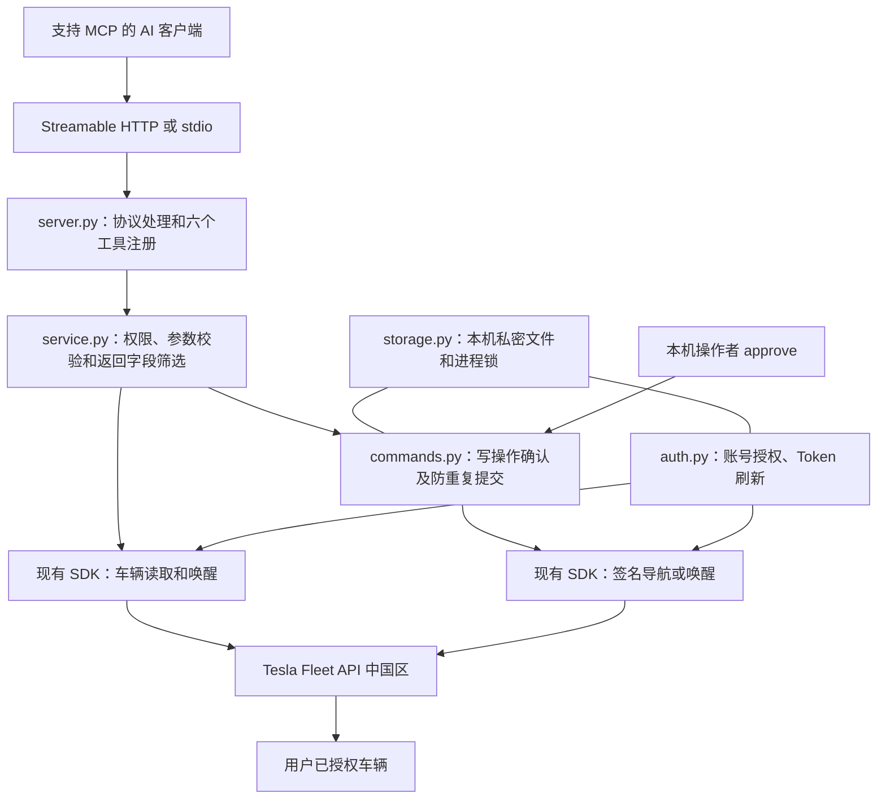
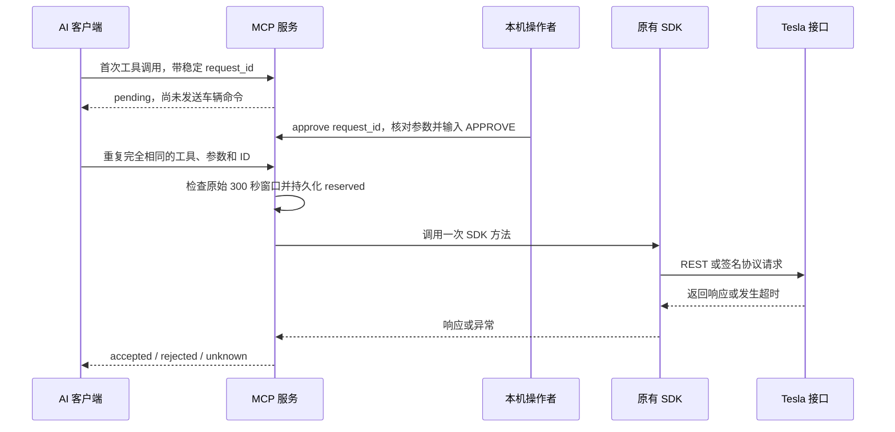

# 项目架构、功能清单与代码目录

[返回项目首页](../../README.md) · [中文文档目录](README.md) · [MCP 配置与使用](../cn_mcp_server.md)

本说明依据当前代码整理。项目由两部分组成：可独立调用的 `tesla_fleet_api` SDK，和新增的
`mcp_server` AI 工具服务。SDK 已有的方法不等于都已经开放为 MCP 工具。
本分支仍未完成中国区真实账号联调和实车验证。

## 一、总体架构



MCP 层复用 SDK，不重写 REST 请求和签名协议；其中唤醒使用 REST，导航使用 SDK 签名路径。
直接使用 SDK 时，还可选择蓝牙、Teslemetry、Tessie 或 Router；本期 MCP 没有接入这些替代路径。
本服务按一个 Tesla 账号、单进程部署设计，可允许同一账号的多个 VIN，但没有多租户用户隔离。

## 二、SDK 功能范围

下表是代码提供的能力类别，不代表中国区所有车辆、账号或固件都已支持，也不代表全部经过实测。

| 功能类别 | 代码中的能力 | MCP 当前覆盖 |
|---|---|---|
| 账号与授权 | OAuth 登录 URL、授权码交换、Token 刷新、区域配置 | 本机 login 与服务自动刷新 |
| 用户与合作方 | 用户资料、区域、部分订单信息、应用注册及公钥查询 | 未开放工具 |
| 车辆信息 | 列表、产品、车辆数据、配置及状态查询 | 列表与筛选后的状态 |
| 定位 | 云端位置数据、SDK 不同传输路径的读取 | 独立位置工具 |
| 唤醒 | 唤醒请求及可选上线等待 | 仅发送唤醒，不等待上线 |
| 导航 | 文本目的地、GPS、超级充电站、多途经点等包装 | 文本目的地、多途经点原始字符串入口 |
| 车辆控制 | 锁车、门盖、车窗、空调、座椅、充电、媒体等 | 未开放这些控制工具 |
| 签名协议 | 私钥加载、会话建立、签名命令、部分图像和遥测配置 | 导航复用签名能力 |
| 蓝牙 | 扫描、连接、配对、状态读取、控制、广播监听 | 未接入 MCP |
| 充电资料 | 充电历史、部分会话信息等 | 未开放工具；部分接口有账号类型限制 |
| 能源设备 | Powerwall 等站点状态、历史、运行设置和部分设备命令 | 未开放工具 |
| 第三方服务 | Teslemetry、Tessie 的客户端与服务特有接口 | 未接入 MCP |
| 多后端路由 | VehicleRouter、EnergySiteRouter 故障切换 | MCP 不使用自动切换 |
| 数据辅助 | 部分观察值归集、蓝牙广播流衔接、电价周期解析、固件比较 | 未提供独立 MCP 工具 |

观察值归集 `funnel.py` 是同步消费端，目前字段集中在锁定、充电口、前备箱状态；
它不负责主动轮询，也不是覆盖全车数据的实时采集平台。
能源云端离网操作仍有明确限制，见[能源设备说明](fleet_api_energy_sites.md)。

## 三、当前六个 MCP 工具

六个工具均已注册；“默认关闭”表示调用时由权限和功能开关拒绝，而不是工具从列表隐藏。

| MCP 工具 | 输入参数 | 输出内容 / 行为 | 默认可调用 |
|---|---|---|---|
| `tesla_list_vehicles` | `page=1` | 每页账号车辆经 VIN 白名单过滤，返回 VIN、名称、在线状态及分页提示 | 是 |
| `tesla_get_vehicle_state` | `vin` | 返回白名单内的电量、充电、空调、锁车、里程、固件字段 | 是 |
| `tesla_get_location` | `vin` | 返回经纬度、方向、时间戳以及存在的原生坐标字段 | 否，需单独放行 |
| `tesla_wake_vehicle` | `vin, request_id` | 准备/执行一次唤醒请求，不自动等待车辆上线 | 否，需命令开关及本机确认 |
| `tesla_navigate_to` | `vin, destination, request_id` | 准备/执行一次文本目的地签名导航 | 否，需命令开关、私钥及本机确认 |
| `tesla_navigate_waypoints` | `vin, waypoints, request_id` | 准备/执行原始字符串形式的多途经点签名导航 | 否，另需实验开关 |

配置中的工具名去掉 `tesla_` 前缀，例如 `TESLA_TOOLS=list_vehicles,get_vehicle_state`。
配置许可还不能替代 Tesla 的实际授权范围和共享车隐私限制。

### 状态工具具体字段

| 返回分组 | 返回字段 |
|---|---|
| `charge_state` | `battery_level` 电量、`charging_state` 充电状态、`battery_range` 接口续航值、`timestamp` 时间戳 |
| `climate_state` | `inside_temp` 车内温度、`outside_temp` 车外温度、`is_climate_on` 空调开关、`timestamp` |
| `vehicle_state` | `locked` 锁定、`odometer` 接口里程值、`car_version` 固件、`timestamp` |

只返回实际存在的字段，不会补造数据。这里的续航和里程直接保留接口值，服务没有单位换算层。
状态工具不返回定位、保存地址或路线。位置要走独立工具，返回数据仍可能是缓存，
带有 `may_be_cached=true`，调用方应检查原始时间戳。

### 多途经点的实际边界

当前 `waypoints` 参数是 Tesla 兼容的原始字符串，不是已经验证可用的“地址数组转路线”功能。
服务只做非空和最大 16 KiB 检查，再交给 SDK；点数上限、载荷结构、中国区固件效果待验证。
没有自动地理编码、地图坐标转换、路线规划，也不会用多次 GPS 请求冒充一个原子多途经点指令。

## 四、MCP 服务支撑功能

| 模块 | 已实现内容 |
|---|---|
| 传输 | Streamable HTTP、stdio；HTTP 使用无状态 JSON 响应模式 |
| HTTP 访问 | 独立 Bearer、固定回环监听、Host/Origin 检查、64 KiB 请求体上限 |
| 车辆权限 | 必填显式 VIN 白名单；多辆车使用逗号分隔 |
| 工具权限 | 工具名称白名单；默认只允许列表和不含位置的状态 |
| 写操作权限 | 命令总开关；多途经点额外实验开关；导航签名私钥 |
| 账号授权 | 中国区默认、随机 OAuth state、回调校验、10 分钟登录有效期、隐藏输入回调 URL |
| Token 管理 | 在需要取 Token 且临近过期时提前 60 秒刷新；并发刷新串行化；保存轮换令牌 |
| 运行生命周期 | HTTP 应用共享一个账号客户端和进程租约，避免每个无状态请求各自初始化 |
| 人工确认 | 本机 CLI 查看精确车辆和参数后输入 `APPROVE`，没有 AI 可调用的 approve 工具 |
| 防重复 | request_id 与参数绑定，提交前先持久化记录；同一 ID 不重放 |
| 异常保护 | 服务层不自动重发结果不明的写请求；取消或中断后保留未知结果 |
| 本地存储 | 私密 JSON 文件、原子替换、同步落盘、文件锁；目录 0700、文件 0600 |
| 隐私处理 | 筛选工具输出，隐藏原始错误体，限制 SDK 调试日志，关闭 HTTP 访问日志 |

HTTP 默认地址 `http://127.0.0.1:8000/mcp`；远程访问需要另外配置受控 HTTPS 网关。
stdio 依靠本机进程与文件权限，不使用 HTTP Bearer。
这里没有连接 SQL Server 或其他业务数据库，Token 和确认记录保存在本机文件。

## 五、写操作流程



`accepted` 是接口接收，不是物理动作成功证明；唤醒尤其不表示车辆已上线。
同一 request_id 永久绑定原参数并阻止重放；相同载荷换 ID，在原准备的 300 秒内也会指向旧记录。
超过窗口的新 ID 是新请求，仍需重新人工确认。防重不能替代车辆端恰好一次执行保证，
SDK 内部会话修复与有限重发仍沿用上游协议实现。
命令记录最多 10,000 条后拒绝新请求，当前没有后台自动清理或归档任务。

## 六、目录与代码职责

```text
python-tesla-fleet-api-cn/
├── README.md                     中文默认首页
├── README.en.md                  保留的英文 SDK 说明
├── LICENSE                       上游 Apache-2.0 许可证
├── DISCLAIMER.md                 致谢、用途、商用与风险说明
├── .env.example                  带中文注释的 MCP 配置示例
├── pyproject.toml                Python 依赖、可选 MCP extra、命令入口
├── uv.lock                       锁定的依赖版本
├── MANIFEST.in                   源码包中的文档和配置样例清单
├── mcp_server/                   新增独立 MCP 服务
│   ├── __main__.py               login / serve / approve 命令入口
│   ├── config.py                 环境变量、VIN 和工具许可、区域及功能开关
│   ├── server.py                 六个工具、HTTP Bearer、传输及共享运行生命周期
│   ├── service.py                SDK 调用编排、输出字段筛选、工具权限检查
│   ├── auth.py                   SDK OAuth 扩展、Token 刷新与持久化
│   ├── commands.py               确认窗口、参数指纹、提交记录和防重复
│   └── storage.py                私密文件、原子写入和进程/记录锁
├── tesla_fleet_api/              可独立安装使用的原有 SDK
│   ├── const.py                  区域地址、权限范围和枚举
│   ├── exceptions.py             SDK 异常类型
│   ├── util.py                   固件版本比较等辅助函数
│   ├── funnel.py                 有限字段的观察值归集，不主动发请求
│   ├── tariff.py                 分时电价解析
│   ├── tesla/
│   │   ├── fleet.py              Fleet HTTP 请求和客户端
│   │   ├── oauth.py              OAuth 地址、授权码交换和刷新
│   │   ├── tesla.py              共享基础能力及私钥加载
│   │   ├── bluetooth.py          蓝牙客户端与发现
│   │   ├── user.py               用户相关接口
│   │   ├── partner.py            应用合作方、公钥与注册接口
│   │   ├── charging.py           充电历史与会话接口
│   │   ├── energysite.py         能源站及设备接口
│   │   ├── jws.py                JWS 签名辅助
│   │   └── vehicle/
│   │       ├── vehicle.py        车辆基础对象
│   │       ├── vehicles.py       车辆对象工厂
│   │       ├── fleet.py          车辆 REST 方法
│   │       ├── signed.py         签名消息经 Fleet 发送
│   │       ├── commands.py       命令 protobuf 构造、签名会话与协议处理
│   │       ├── bluetooth.py      车辆蓝牙传输与确认逻辑
│   │       ├── broadcast.py      广播监听
│   │       ├── stream_glue.py    蓝牙广播和流消费接口衔接
│   │       └── proto/            协议包兼容重导出，不是本地重新生成的 REST 层
│   ├── router/                   车辆/能源多后端路由及能源字段合并
│   ├── teslemetry/               Teslemetry 第三方服务适配
│   └── tessie/                   Tessie 第三方服务适配
├── tests/
│   ├── test_cn_oauth.py          中国区 OAuth 回归
│   ├── test_mcp_service.py       配置、权限、Token、确认和持久化防重
│   ├── test_mcp_transports.py    内存、真实本机 HTTP、stdio 子进程测试
│   └── 其他 test_*.py           原有 SDK 的签名、蓝牙、路由等测试
├── docs/
│   ├── cn_mcp_server.md          中国区接口核实与 MCP 完整使用说明
│   ├── zh-CN/                   中文使用指南、术语、排障及本架构文档
│   └── 其他英文文档              保留的上游详细说明，附中文入口
└── .github/workflows/           代码检查、测试、构建及上游发布流程
```

运行时状态目录由 `TESLA_STATE_DIR` 指定，默认是工作目录下的 `.tesla-mcp/`：

```text
.tesla-mcp/
├── tokens.json                  访问令牌、刷新令牌、过期时间、区域和应用标识
├── commands.json                命令参数、指纹、状态和确认过期时间
├── service.lock                 阻止同一目录的多个服务/login 同时运行
└── journal.lock                 保护命令记录的读写
```

该目录包含敏感信息，不应提交 Git。签名私钥由单独路径配置，不必放进该目录。

## 七、验证状态和未覆盖项

已有测试覆盖 CN OAuth、权限、Token 轮换、确认过期、并发重复提交、取消后不重放、
模拟 SDK 委托，以及实际本机 Streamable HTTP 和 stdio 的初始化、列工具和调用边界。
这些测试没有使用真实中国区账号或车辆，也没有证明任何具体车型已经执行成功。

当前没有车辆管理网页、多租户账号系统、云端托管登录回调、MCP OAuth 动态注册、
定时任务、完整行程数据库或所有 SDK 方法的自动 MCP 映射。
小智 AI、Microsoft Agent Framework 等客户端只有在支持相应传输和认证方式时才具备接入前提，
本分支尚未完成这些具体产品的实际联调。
